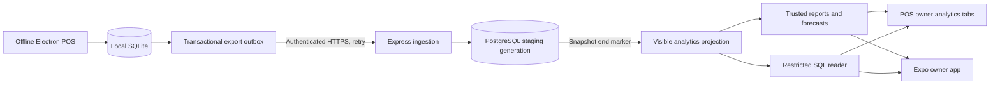

# Data flow and recovery

## Synchronization contract

Migration 5 creates an explicit export allowlist, triggers, a singleton metadata record, lineage ID and durable outbox. Triggers cover insert/update/delete for every synchronized table, including direct SQL and existing service transactions. Rolled-back business writes roll back their events. Tables outside the allowlist, including users, held carts and audit logs, never enter the analytics stream.

Each event has a UUID, store/device identity, version, generation UUID and monotonic sequence. Payloads retain historical line prices/costs and exclude credentials, customer names/contact information, payment references and free-text notes. Customer entries include only opaque IDs and numeric credit/loyalty summaries. Supplier names are retained for account reporting.

Initial enrollment materializes an ordered begin marker, row snapshot and end marker in one SQLite transaction, then enables live capture. This transaction briefly serializes local writers; network transfer never holds a SQLite transaction. Large stores should measure the snapshot duration before enrollment during trading hours. Snapshot pages are durable and resume after restarts; later local changes follow the end marker.

PostgreSQL locks the device stream, verifies identities/order, validates the export fields, deduplicates event identities/digests and commits ingestion plus acknowledgement together. Snapshots are staged under a new generation; the last complete cloud generation remains visible until the end marker. Incremental batches commit atomically, although a large local transaction may span more than one upload batch; owner clients must use the displayed sync freshness rather than assume an instantaneous complete mirror.

One worker runs per desktop process; the existing application single-instance lock prevents ordinary duplicate desktop launches. There is one active source credential per cloud store. Multiple independent desktops editing the same store are intentionally unsupported. This is one-way projection, with no cloud-to-local business writes.

The desktop saves an encrypted external high-water mark before deleting acknowledged outbox entries. Duplicated sends are harmless; an obsolete generation or a missing sequence causes a pause. Invalid events are quarantined and block subsequent events until an owner rebuilds. The worker compares sorted SHA-256 projection fingerprints and per-table counts when its queue is empty. A mismatch pauses synchronization rather than silently accepting drift.

## Restore and rebuild

Before an application restore replaces SQLite, the worker drains its in-flight request, stops and marks the external vault as restored. On reconnect it requires an owner rebuild. External database replacement is also checked against the encrypted generation, lineage and sequence high-water mark. This detects ordinary rollback/replacement but is not tamper-proof against replacement of both the database and its encrypted vault together.

The owner chooses Rebuild cloud copy and confirms replacement. The server switches the device to a fresh stream generation; the desktop rematerializes its current snapshot. Old cloud reports remain visible until the replacement end marker. If enrollment/reset or credential storage is interrupted, reconnect/rebuild from desktop settings; never manually delete outbox rows to bypass a missing sequence. Keep the desktop's safety backup and verify reporting totals after a restore.

Device revocation is available through POS → Analytics → Connection or the native mobile Connection tab when the API is reachable. Normal billing is unaffected.

## Reporting and forecasting definitions

- Revenue is sale totals minus refunds occurring in the selected store-local period.
- COGS is original sale cost minus returned cost recorded by the POS. Damaged returns follow the POS cost treatment.
- Gross profit is revenue minus COGS; net profit subtracts dated expenses.
- Product/category revenue uses allocated merchandise lines, so bag charges/rounding can differ from the overall total.
- Credit, supplier balances and inventory show current synchronized state rather than historical date-filtered balances.
- Forecasts use gross units sold, not net refund-adjusted units. Coverage starts at the first known sale/stock movement, up to 180 completed days. Missing days inside coverage are zeros; today is excluded.
- Moving averages and seven-day seasonal naive forecasts are compared using rolling one-day chronological backtests across up to 28 days. MAE is reported in product units, with no invented confidence percentage.
- New/zero-sales products show insufficient history. Zeros with recorded stock depletion produce a warning that observed sales may understate demand; exact lost demand is not estimated.
- Reorder preferences initially apply store-wide: supplier lead time, safety stock, minimum order, multiple and horizon. Usable stock excludes batches already expired and, conservatively, all stock expiring before expected replenishment. This may over-order fast-selling near-expiry stock; review the explanation before ordering. No purchase orders are placed automatically.

The initial projection implementation bounds each analytics load to 250,000 records. Larger stores receive an explicit capacity error and need indexed SQL aggregates/materialized summaries before raising that limit. It is not a multi-branch data warehouse.

## Access boundaries

Owner sessions and device secrets are separate opaque tokens stored as hashes on the server. The browser client and cookie authentication have been removed. Native clients use bearer sessions; the POS keeps its token in main-process memory and the mobile app uses SecureStore. Requests carrying a browser Origin are rejected. Sessions expire after 24 hours and logout revokes them. Enrollment codes expire after 10 minutes and are consumed atomically.

Every owner store route checks membership. Device ingestion binds store identity to its credential. Generated SQL runs under a NOLOGIN/NOBYPASSRLS reader role with SELECT-only access and forced store row policies. Product strings and questions are treated as untrusted data; the model cannot change the session's store setting or choose a privileged role.

Mobile tokens and limited cached summaries use Expo SecureStore. Cache namespaces include account and store; a manifest is published only after all encrypted chunks are written. Logout/account changes await pending cache writes and remove all indexed chunks. Cached screens show their saved timestamp and warn that lists may be incomplete. The owner can view cached summaries offline, but asking new questions and saving preferences require connectivity.

References used for platform boundaries: [Electron safeStorage](https://www.electronjs.org/docs/latest/api/safe-storage), [PostgreSQL row security](https://www.postgresql.org/docs/current/ddl-rowsecurity.html), [Expo SecureStore](https://docs.expo.dev/versions/latest/sdk/securestore/).

## POS screen and mobile access

The desktop exposes one owner-only sidebar topic with horizontal subtopics. Named, validated IPC commands handle report reads, questions, preferences, exports and direct device pairing. Every command enforces the local owner role independently of UI navigation. API addresses require HTTPS except local development; there is no iframe, arbitrary URL proxy or relaxed renderer CSP. Desktop analytic panels clear when the configured server is unavailable, while local billing continues. Lock, account switches, restore and shutdown clear/dispose the owner session and cancel pending requests.

The mobile app connects directly to the same API and account. Its Connection tab is available even when report loading fails; limited cached summaries remain explicitly labeled offline.
